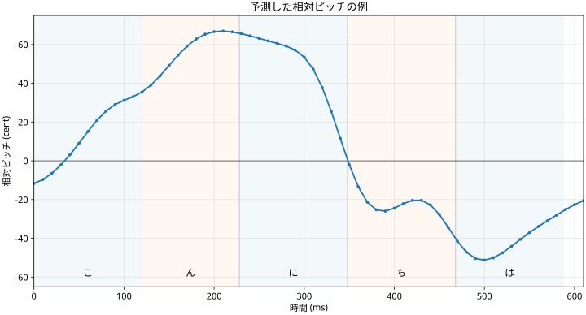

# 音声合成の仕組み

UtauTTSはUTAUボイスバンクの原音をつなぎ合わせて文章を読み上げる、連結型の音声合成システムです。

文に合う原音（「あ」「か」「a か」など）を選び、音高（ピッチ）と音素の長さを変えて重ねます。ピッチの変化とモーラごとの音量は抑揚モデルが予測します。DiffSinger音源では、原音の代わりに音源の音響モデルが声を作ります。

テキストからWAVを出力するまでの流れは次のとおりです。

1. テキスト解析: テキストを読みとモーラに分ける
2. 原音候補の抽出: ボイスバンクから原音の候補を集める
3. 配置時刻の決定: `oto.ini`の設定から、各原音を置く時刻を決める
4. 抑揚・音量の予測: 10msごとのピッチ曲線と、モーラごとの音量を求める
5. 波形合成: 原音の長さと高さを変え、重ねて1つの波形にする

## 1. テキスト解析（読み・モーラ分解）

日本語は文字数ではなくモーラ（拍）を単位にします。「こんにちは」は5モーラ、「きゃ」は2文字で1モーラです。

読みとモーラを求めるときに、Open JTalkで単語の境界、品詞、アクセント句の長さ、アクセント核の位置などの言語情報も得ます。

中国語も同じ流れで処理しますが、単位はモーラの代わりに音節です。音節を子音（声母）・母音（韻母）などの音素に分け、アクセントの代わりに声調を使います。英語と中国語は原音をつながず、参照音声に近いフレームを選んで合成します（[9. 参照の読み上げ](#9-参照の読み上げ)）。

## 2. 原音選択（ユニット選択）

UTAUボイスバンクの主な収録形式は次のとおりです。

| 形式 | 原音の例 | 特徴 |
| --- | --- | --- |
| CV（単独音） | か | 子音と母音を1つの原音で扱う |
| VCV（連続音） | a か | 前の母音から次の音への渡りを含む |
| CVVC | あ + a k + か | 母音から次の子音へつなぐVC原音を間に挟む |

`oto.ini`の設定値は基本的にそのまま使います。ただしVCVで、先行発声がモーラ長に対して長すぎる場合や、設定値が矛盾する場合は、子音の渡りを保ったまま適した長さに縮めます。

文の区切りごとに、音階や収録形式の違う原音の候補を集め、発音の適合スコア（Target Cost）と接続スコア（Concatenation Cost）から組み合わせを選びます。

評価関数は次のとおりです。

$$S(U)=\sum_i L(u_i)+\sum_{i=2}^{N}J(u_{i-1},u_i)$$

- $U=(u_1,u_2,\ldots,u_N)$: 選んだ原音の列（CVVCのVC原音と本体の原音の組も1つの候補として扱う）
- $L(u_i)$: モーラに対する原音の適合度（指定の音階・音色・収録形式、代わりの候補へ落とした回数などを評価）
- $J(u_{i-1},u_i)$: 前後の原音のつながりのよさ（境界付近の音量、スペクトル包絡、基本周波数 $F_0$ などを評価）

合計が最も高い経路をViterbiアルゴリズムで探します。

同じ録音WAVの中で続く原音を選んだときは、連続性の加点（6〜9点）を足します。間隔が500ms以下なら9点で、2000msで6点まで直線的に下がります。これにより、マルチモーラ音源などで渡りの音を選び漏らすことを防ぎます。

候補は必要な音素の文脈とボイスバンクの定義で絞り込むので、接続スコアだけを理由に別の読みや違う音素へ入れ替わることはありません。

### （参考）関連する音声合成方式

UtauTTSの原音選択は、AppleのSiri（[Apple解説](https://machinelearning.apple.com/research/siri-voices) / [Interspeech 2017論文](https://www.isca-archive.org/interspeech_2017/capes17_interspeech.html)）が使うHybrid Unit Selectionと考え方が共通しています。

Siriはニューラルネットワークで音響特徴の分布を予測し、Target costとConcatenation costを求めて、Viterbi探索で単位（Unit）をつなぎます。UtauTTSも同じ方法ですが、Siriが数万〜数百万の単位（half-phone）を持つのに対し、一般のUTAUボイスバンクでは1つの文脈の候補が数個ほどしかありません。

## 3. モーラ長の決定

標準の日本語抑揚モデル（`frame-intonation-tcn-v12`）はモーラ長を予測しません。モーラ長はGUIで指定した基準値に、言語ごとの規則による倍率を掛けて決めます。「ん」は0.9倍、「ー」は1.2倍、「っ」は1.0倍です。GUIでモーラごとに長さを指定したときは、その値を使います。

モーラ $i$ の長さを $D_i$ とすると、基準時刻 $T_i$ は次のように前から順に求まります。

$$T_1=0,\qquad T_{i+1}=T_i+D_i$$

句読点や記号の位置には、休止を別の長さとして入れます。句読点に応じた休止長の補正が有効なときは、休止長の基準に、読点は0.7倍、句点は1.0倍、疑問符は1.15倍、「…」は1.3倍を掛け、発話の末尾ではさらに1.1倍にします。

## 4. 原音設定（oto.ini）の適用

原音WAVのどの範囲を使い、どこが子音かは`oto.ini`に書かれています。

| パラメータ | 概要 |
| --- | --- |
| offset | 原音の再生を始める位置（WAVの先頭からのミリ秒） |
| consonant | 固定範囲（長さを変えるときに伸縮しない子音の区間） |
| cutoff | 除外範囲（WAVの末尾から除く長さ、または使う長さの指定） |
| preutterance | 先行発声（発声の基準時刻より前に置く長さ） |
| overlap | オーバーラップ（前の原音と重ねる範囲） |

モーラ $i$ の基準時刻を $T_i$、先行発声を $P_i$ とすると、原音を置き始める時刻 $B_i$ は次のとおりです。

$$B_i=T_i-P_i$$

子音（「か」の /k/ など）は母音の立ち上がりより前で鳴り始めるので、先行発声の分だけ前に置いて直前の音と重ねます。

文頭で $B_1 < 0$ になるときは、出力の先頭が欠けないように、次の長さ $M$ の無音を先頭に入れます。

$$M=\max(0,-\min_i B_i)$$

GUIの「文頭の長さ」を指定すると、この無音に上限を設けて、先行発声に入っている不要な雑音を切り落とせます。

## 5. 包絡線（エンベロープ）による波形接続

原音をそのまま足すと、重なった部分の音量が大きくなりすぎたり、境界でポップノイズが出たりします。そこで包絡線（エンベロープ）を掛けてなめらかにつなぎます。

- Classic UTAU（wavtool方式）: 各原音に5点の包絡線（$p_0 \sim p_4$）を掛けて、フェードインとフェードアウトをします。出力 $y(t)$ は各原音の波形 $x_i$ と包絡線 $e_i$ の積の和です。
  $$y(t)=\sum_i e_i(t-B_i)\,x_i(t-B_i)$$

- UtauTTS WORLD phrase（特徴量合成方式）: 波形は足さず、各原音から求めたWORLDの音響特徴量（ピッチ、スペクトル包絡、非周期性指標）を包絡線の重みで混ぜ、重みの和で正規化してから、まとめて合成します。これにより、波形を足すときに起きる音量の膨らみや位相の干渉を防ぎます。

## 6. 音素長の制御（伸縮処理）

原音の長さはふつう指定したモーラ長と違います。ただ、全体を同じ比で伸縮すると子音の破裂や移り変わりが崩れ、発音が変わるおそれがあります（子音を縮めすぎて「す」が「つ」になるなど）。

そのため、`consonant`（固定範囲）の子音はなるべく長さを保ち、主に後ろの母音を伸縮します。

- Classic UTAU: resamplerが原音ごとに指定の長さと高さへ変換します。
- UtauTTS WORLD phrase: 音響特徴量を並べるときに、子音と母音の時間の配分を決めます。大きく伸ばすときは、母音が伸びすぎないように抑えます。さらに、自然音声のモデルが予測した子音から母音への移る速さに合わせて、モーラの中の時間の配分を直します（句末のモーラなどを除く）。

## 7. 抑揚（ピッチ・音量）の予測

抑揚モデルは10msごとのピッチ（音高）の変化と、モーラごとの音量の倍率（0.75〜1.3倍）を出力します。

### 予測と単位の変換
入力は音素の文脈、モーラの中の位置、単語の境界、アクセント句の情報、品詞などです。軽量なTCN（Temporal Convolutional Network）で前後約5秒の文脈を見て、ピッチの相対値（cent）を予測します。

centは周波数の比の単位で、100 centが半音、1200 centが1オクターブです。モデルは絶対周波数（Hz）ではなく、話者によらない相対的な変化を出力します。

原音の基本周波数を $F_{\mathrm{src},i}$、各種の補正値を $q_i$、予測したピッチを $c(t)$ とすると、目標の周波数 $F_{\mathrm{target},i}(t)$ は次のとおりです。

$$F_{\mathrm{target},i}(t) = F_{\mathrm{src},i} \cdot q_i \cdot 2^{c(t)/1200}$$

これにより、ボイスバンクの声質や高さの感じを保ったまま抑揚を付けられます。

### 補正と手動調整
曲線の振れ幅は抑揚の強さ（標準は4）に合わせて変わります。疑問文の語尾上げなど、文末の音調も補正します。`utautts-world-phrase`レンダラーでは、無声破裂音の直後の立ち上がりなど、自然な発声にある細かなピッチの揺れ（Micro-prosody）も加えます。

GUIで抑揚を直すと、そのcent値を自動予測の曲線に足すか、置き換えます。

## 8. レンダラー（Renderer）による処理の違い

テキスト解析から抑揚の予測までは共通で、波形の作り方がレンダラーで違います。

| レンダラー | 処理内容 |
| --- | --- |
| UtauTTS WORLD phrase | 原音をWORLDで分析し、音響特徴量を並べて補間し、フレーズごとにまとめて合成し直す |
| Classic UTAU | UTAU互換のresamplerで原音を1つずつ加工し、wavtoolなどで足し合わせてつなぐ |

DiffSinger音源はこの連結の流れを通らず、求めたタイミングと抑揚をDiffSingerの音響モデルに直接渡して声を作ります（[DiffSinger](diffsinger.md)）。

## 9. 参照の読み上げ

英語と中国語はUTAUの原音をつなぐ方式では聞き取れる発音になりませんでした。そこで参照用の音声合成（Kokoro-82M）に文を読ませ、その音声に近いフレームを音源の録音から選んで、WORLDで合成し直します。

1. 文をKokoroの音素記号に直して読ませ、参照音声と内部のF0を得る
2. 参照音声と音源の録音から、20msごとの特徴量を求める
3. 参照の各フレームに近い音源のフレームを、前後のフレームも含めて選ぶ
4. 選んだフレームのWORLD音響特徴量を平均し、参照のF0で合成する

参照TTSの種類は言語ごとに決まります。英語はKokoro-82M（声はaf_heart）、中国語はKokoro-82M-v1.1-zh（声はzf_001）です。音素記号の作り方だけが言語で変わり、特徴量・照合・合成は共通です。

### 参照音声の生成

英語のKokoroの音素記号は文の語ごとにmisakiの英語辞書を引いて決めます。次の語は英語の読み（ARPAbet、例: `HH AH0 L OW1`）から記号に直し、強勢の記号を母音の前に置きます。

- 辞書にない語
- 利用者辞書に登録した語
- 本文から作った自動の読みと読みが違う語（読みを直した語）

読みの語の数が自動の読みと違うときは、すべての語を読みから直します。語の区切りの`SP`は読点にします。疑問文は「?」で、それ以外は「.」で終えます。

中国語は漢字をピンイン（例: `ni3 hao3`）に直し、声母と韻母を注音符号にして声調の数字を付けます（例: `ni3 hao3` → `ㄋㄧ3ㄏㄠ3`）。表はmisakiの中国語G2Pと同じです。`zi`・`ci`・`si`の`i`と、`zhi`・`chi`・`shi`・`ri`の`i`は、別の韻母として書き分けます。休止は読点にします。

Kokoroは入力記号ごとの長さ（25ms単位）、内部で予測したF0（12.5msごと）、24kHzの音声を出力します。長さとF0は音声を作る前に決まるので、編集画面の予測では音声を作らずに止めます。

### 特徴量

特徴量にはLibriSpeechの960時間で学習したWavLM base+（`microsoft/wavlm-base-plus`）の6層目を使います。音声を16kHzにして、20msごとに768次元の値を求めます。

### 音源の索引

照合の前に、`oto.ini`にある録音を解析して、音源ごとに索引を作ります。音高や声色ごとの収録がある音源では、C4に当たる通常の声の録音を使います。PCM以外など、読めない形式のWAVは飛ばします。

| 内容 | 周期 | 解析 |
| --- | --- | --- |
| 特徴量 | 20ms | WavLM base+の6層目 |
| F0 | 5ms | Harvest（71〜1100Hz） |
| スペクトル包絡 | 5ms | CheapTrick。60次に符号化 |
| 非周期性指標 | 5ms | D4C（threshold 0.85）。3kHzごとの帯域に符号化 |

各ファイルで、包絡の符号の0次（音量）が95パーセンタイルより9（約45dB）以上小さいフレームは、無音として除きます。

GUIは、言語が英語と判定された音源の索引を読み込み時に作ります。それ以外は、参照の合成をするときに作ります。索引は利用者ごとのキャッシュフォルダに保存し、使う録音の一覧、大きさ、更新時刻のどれかが変わると作り直します。索引は参照TTSの種類に依存しません。

### フレームの照合

参照のフレーム $t$ と音源のフレーム $j$ の近さを、特徴量のコサイン類似度 $\cos(q_t,b_j)$ で測ります。有声か無声かが食い違う組からは0.5を引きます。

$$s(t,j)=\cos(q_t,b_j)-0.5\,[\,v_t\ne v_j\,]$$

1フレームずつ最も近いものを選ぶと、20msごとに別の録音のフレームへ飛び、声が揺れて聞こえます。そこで、前後2フレームまでの近さを、同じ録音の中で続くフレームどうしで平均した値で選びます。

$$S(t,j)=\frac{\sum_{\delta=-2}^{2}w_\delta\,s(t+\delta,\,j+\delta)}{\sum_{\delta=-2}^{2}w_\delta},\qquad w_0=1,\quad w_{\pm1}=w_{\pm2}=0.5$$

$j+\delta$ が別の録音にまたがる項は、分子と分母の両方から除きます。$S(t,j)$ が高い順に4フレームを選びます。前後を含めると、録音の中で続くフレームが選ばれやすくなり、揺れが減ります。選ぶフレームを4つより減らすと、揺れが戻ります。

### 波形合成

選んだ4フレームについて、符号化したスペクトル包絡と非周期性指標を平均し、さらに時間方向に3フレームで平均します。平均でこもった音になるのを抑えるため、包絡の符号の2次以降の係数を1.4倍して強調し、全体の大きさは強調前に合わせます。

F0はKokoroのF0から作ります。有声区間のF0を対数で約20msの幅でなめらかにして、5msごとに直します。中央値が音高の指定（指定がなければ音源のF0の中央値）になるようにF0全体を移し、動きの幅を抑揚の強さの倍率 $k$（抑揚の強さ÷4）で変えます。

$$F_0(t)=F_{\mathrm{center}}\cdot\left(\frac{F_{\mathrm{Kokoro}}(t)}{\mathrm{median}\,F_{\mathrm{Kokoro}}}\right)^{k}$$

Kokoroが無音の区間では、選んだフレームが小さな雑音として残ります。そこで、Kokoroの音量（5msごと、95パーセンタイルを0dB）が-40dBより下がった分だけ、出力も最大40dBまで下げます。下げる量は約10msの幅でなめらかにします。

最後に、音源の標本化周波数と5msの周期で、WORLDで合成します。振幅の最大が0.98を超えるときは、全体を0.98に収めます。

### 手動の編集

編集画面のモーラ長はKokoroの入力記号をモーラに割り当てて求めます。英語は語の記号を語の中のモーラへ音素の数の比で順に分けます。語の後ろの空白は語の最後のモーラに、読点は休止のモーラに入れます。文末の記号と末尾の境界記号は文末の休止に入れ、文末に休止がなければ最後のモーラに入れます。中国語など1音節が1モーラになる言語は、記号とモーラを1対1で対応させます。モーラ長は割り当てた記号の長さの合計です。

モーラ長を手で直すと、そのモーラの記号の長さを、比を保って目標に合わせます（25ms単位）。その長さを指定してKokoroで読み直します。手で直した抑揚は中心に移したあとのF0にセントのずれとして足します。
