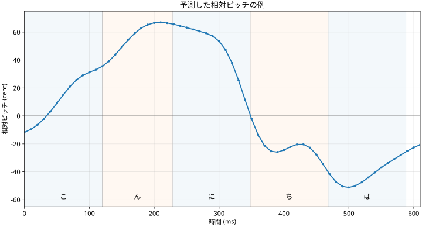

# 音声合成の仕組み

UtauTTSはUTAUボイスバンクの原音で文章を読み上げる音声合成システムです。日本語は原音をつなぎ合わせる波形合成、英語・中国語・スペイン語・ポルトガル語は参照照合で読み上げます。

波形合成では文に合う原音（「あ」「か」「a か」など）を選び、音高（ピッチ）と音素の長さを変えて重ねます。ピッチの変化とモーラごとの音量は抑揚モデルが予測します。

波形合成でテキストからWAVを出力するまでの流れは次のとおりです。

1. テキスト解析: テキストを読みとモーラに分ける
2. 原音候補の抽出: ボイスバンクから原音の候補を集める
3. 配置時刻の決定: `oto.ini` の設定から、各原音を置く時刻を決める
4. 抑揚・音量の予測: 10msごとのピッチ曲線とモーラごとの音量を求める
5. 波形合成: 原音の長さと高さを変え、重ねて1つの波形にする

参照照合は、参照TTSが読んだ音声に近いフレームを音源から選ぶ方式です（[9. 参照照合](#9-参照照合)）。

## 1. テキスト解析（読み・モーラ分解）

日本語は文字数ではなくモーラ（拍）を単位にします。「こんにちは」は5モーラ、「きゃ」は2文字で1モーラです。

読みとモーラを求めるとき、Open JTalkから単語境界、品詞、アクセント句の長さ、アクセント核の位置などの言語情報も取得します。

中国語の読みの単位はモーラの代わりに音節です。音節を子音（声母）・母音（韻母）などの音素に分け、アクセントの代わりに声調を使います。

## 2. 原音選択（ユニット選択）

UTAUボイスバンクの主な収録形式は次のとおりです。

| 形式 | 原音の例 | 特徴 |
| --- | --- | --- |
| CV（単独音） | か | 子音と母音を1つの原音で扱う |
| VCV（連続音） | a か | 前の母音から次の音への渡りを含む |
| CVVC | あ + a k + か | 母音から次の子音へつなぐVC原音を間に挟む |

`oto.ini` の設定値は基本的にそのまま使います。ただしVCVで先行発声がモーラ長に対して長すぎる場合や設定値が矛盾する場合は、子音の渡りを保ったまま適切な長さに縮めます。

文の区切りごとに、音階や収録形式の違う原音候補を集め、発音の適合スコア（Target Cost）と接続スコア（Concatenation Cost）から組み合わせを選びます。

評価関数は次のとおりです。

$$S(U)=\sum_i L(u_i)+\sum_{i=2}^{N}J(u_{i-1},u_i)$$

- $U=(u_1,u_2,\ldots,u_N)$: 選んだ原音の列（CVVCのVC原音と本体の原音の組も1つの候補として扱う）
- $L(u_i)$: モーラに対する原音の適合度（指定の音階・音色・収録形式、代わりの候補へ落とした回数などを評価）
- $J(u_{i-1},u_i)$: 前後の原音のつながりのよさ（境界付近の音量、スペクトル包絡、基本周波数 $F_0$ などを評価）

合計が最も高い経路をViterbiアルゴリズムで探します。

同じ録音WAV内で連続する原音を選んだときは、連続性の加点（6〜9点）を与えます。間隔が500ms以下なら9点で、2000msにかけて6点まで直線的に下がります。これにより、マルチモーラ音源などで渡りの音を選び漏らすのを防ぎます。

候補は必要な音素の文脈とボイスバンクの定義で絞り込むため、接続スコアだけを理由に別の読みや違う音素へ入れ替わることはありません。

### （参考）関連する音声合成方式

UtauTTSの原音選択はAppleのSiri（[Apple解説](https://machinelearning.apple.com/research/siri-voices) / [Interspeech 2017論文](https://www.isca-archive.org/interspeech_2017/capes17_interspeech.html)）が使うHybrid Unit Selectionと考え方が共通しています。

Siriはニューラルネットワークで音響特徴の分布を予測し、Target costとConcatenation costを求めてViterbi探索で単位（Unit）をつなぎます。UtauTTSも同じ方法ですが、Siriが数万〜数百万の単位（half-phone）を持つのに対し、一般のUTAUボイスバンクでは1つの文脈の候補が数個ほどしかありません。

## 3. モーラ長の決定

標準の日本語抑揚モデル（`frame-intonation-tcn-v12`）はモーラ長を予測しません。モーラ長はGUIで指定した基準値に言語ごとの規則倍率を掛けて決めます（「ん」0.9倍、「ー」1.2倍、「っ」1.0倍）。GUIでモーラごとに長さを指定したときはその値を使います。

モーラ $i$ の長さを $D_i$ とすると、基準時刻 $T_i$ は前から順に次のように求まります。

$$T_1=0,\qquad T_{i+1}=T_i+D_i$$

句読点や記号の位置には休止を入れます。句読点に応じた休止長補正が有効なときは、休止長の基準に読点0.7倍、句点1.0倍、疑問符1.15倍、「…」1.3倍を掛け、発話の末尾ではさらに1.1倍にします。

## 4. 原音設定（oto.ini）の適用

原音WAVのどの範囲を使い、どこが子音かは `oto.ini` に書かれています。

| パラメータ | 概要 |
| --- | --- |
| offset | 原音の再生を始める位置（WAVの先頭からのミリ秒） |
| consonant | 固定範囲（長さを変えるときに伸縮しない子音の区間） |
| cutoff | 除外範囲（WAVの末尾から除く長さ、または使う長さの指定） |
| preutterance | 先行発声（発声の基準時刻より前に置く長さ） |
| overlap | オーバーラップ（前の原音と重ねる範囲） |

モーラ $i$ の基準時刻を $T_i$、先行発声を $P_i$ とすると、原音を置き始める時刻 $B_i$ は次のとおりです。

$$B_i=T_i-P_i$$

子音（「か」の /k/ など）は母音の立ち上がりより前で鳴り始めるため、先行発声の分だけ前に置いて直前の音と重ねます。

文頭で $B_1 < 0$ になるときは、出力の先頭が欠けないように、次の長さ $M$ の無音を先頭に入れます。

$$M=\max(0,-\min_i B_i)$$

GUIの「文頭の長さ」を指定すると、この無音に上限を設けて先行発声に入っている不要な雑音を切り落とせます。

## 5. 包絡線（エンベロープ）による波形接続

原音をそのまま足すと、重なった部分の音量が大きくなりすぎたり境界でポップノイズが出たりします。そこで包絡線（エンベロープ）を掛けてなめらかにつなぎます。

波形は足さず、各原音から求めたWORLDの音響特徴量（ピッチ、スペクトル包絡、非周期性指標）を包絡線の重みで混ぜ、重みの和で正規化してからまとめて合成します。これにより、波形の加算で起きる音量の膨らみや位相の干渉を防ぎます。

## 6. 音素長の制御（伸縮処理）

原音の長さはふつう指定したモーラ長と異なります。全体を同じ比で伸縮すると子音の破裂や移り変わりが崩れ、別の発音に聞こえるおそれがあります（子音を縮めすぎて「す」が「つ」になるなど）。

そのため、`consonant`（固定範囲）の子音はなるべく長さを保ち、主に後ろの母音を伸縮します。

音響特徴量を並べるときに子音と母音の時間配分を決め、大きく伸ばすときは母音が伸びすぎないように抑えます。さらに、自然音声モデルが予測した子音から母音への遷移速度に合わせて、モーラ内の時間配分を調整します（句末モーラなどを除く）。

## 7. 抑揚（ピッチ・音量）の予測

抑揚モデルは10msごとのピッチ（音高）の変化と、モーラごとの音量倍率（0.75〜1.3倍）を出力します。

### 予測と単位の変換
入力は音素の文脈、モーラ内の位置、単語境界、アクセント句情報、品詞などです。軽量なTCN（Temporal Convolutional Network）で前後約5秒の文脈を参照し、ピッチの相対値（cent）を予測します。

centは周波数の比の単位で、100 centが半音、1200 centが1オクターブです。モデルは絶対周波数（Hz）ではなく、話者によらない相対的な変化を出力します。

原音の基本周波数を $F_{\mathrm{src},i}$、各種の補正値を $q_i$、予測したピッチを $c(t)$ とすると、目標の周波数 $F_{\mathrm{target},i}(t)$ は次のとおりです。

$$F_{\mathrm{target},i}(t) = F_{\mathrm{src},i} \cdot q_i \cdot 2^{c(t)/1200}$$

これにより、ボイスバンクの声質や高さの印象を保ったまま抑揚を付けられます。

### 補正と手動調整
曲線の振れ幅は抑揚の強さ（標準は4）に合わせて変わります。疑問文の語尾上げなど文末の音調も補正し、波形合成では無声破裂音の直後の立ち上がりといった自然な発声の細かなピッチの揺れ（Micro-prosody）も加えます。

GUIで抑揚を編集すると、そのcent値を自動予測の曲線に加算、または置き換えます。

## 8. 波形の合成

原音をWORLDで分析し、音響特徴量を並べて補間し、フレーズごとにまとめて合成し直します。

## 9. 参照照合

英語と中国語はUTAUの原音をつなぐ方式では聞き取れる発音になりませんでした。そのため日本語以外では参照用の音声合成（Kokoro-82M）に文を読ませ、その音声に近いフレームを音源の録音から選んでWORLDで再合成します。

1. 文をKokoroの音素記号に変換して読ませ、参照音声と内部のF0を得る
2. 参照音声と音源の録音から、20msごとの特徴量を抽出する
3. 参照の各フレームに近い音源フレームを、前後のフレームも含めて選ぶ
4. 選んだフレームのWORLD音響特徴量を平均し、参照のF0で合成する

参照TTSは言語ごとに決まります。英語はKokoro-82M（声はaf_heart）、中国語はKokoro-82M-v1.1-zh（声はzf_001）、スペイン語はKokoro-82M（声はef_dora）、ポルトガル語はKokoro-82M（声はpf_dora）です。音素記号の作り方だけが言語で変わり、特徴量・照合・合成は共通です。

### 参照音声の生成

英語のKokoro音素記号は文の語ごとにmisakiの英語辞書を引いて決めます。misaki・CMUdict・LibriSpeechのいずれにもない語は同梱のGRU（g2p-en）で読みを推定します。大文字の並びが頭字語なら字読みし、語として読む略語は辞書の読みを使います。read、live、lead、use、recordなどの同綴異音語は前後の語から読みを選び、小文字だけの擬音などは従来の綴り規則で読みます。次の語は英語の読み（ARPAbet、例: `HH AH0 L OW1`）から記号に変換し、強勢記号を母音の前に置きます。

- 辞書にない語
- ユーザー辞書に登録した語
- 本文から作った自動の読みと読みが違う語（読みを修正した語）

読みの語数が自動の読みと違うときは、すべての語を読みから変換します。語区切りの `SP` は読点にし、疑問文は「?」、それ以外は「.」で終えます。

中国語は漢字をピンイン（`ni3 hao3`）に変換し、声母と韻母を注音符号にして声調の数字を付けた形（`ㄋㄧ3ㄏㄠ3`）にします。対応表はmisakiの中国語G2Pと同じです。`zi`・`ci`・`si` の `i` と、`zhi`・`chi`・`shi`・`ri` の `i` は別の韻母として書き分け、休止（`|`）は読点にします。

Kokoroは入力記号ごとの長さ（25ms単位）、内部で予測したF0（12.5msごと）、24kHzの音声を出力します。長さとF0は音声を作る前に決まるため、編集画面の予測時は音声を作らずに止めます。

ポルトガル語は数字・小数・通貨を語に展開してから読みます。中国語は百分率を「百分之〜」に変換し、文に混ざったラテン文字は外来語辞書か字読みでPinyinにします。スペイン語とポルトガル語の英語ブランド名は言語別の外来語辞書を先に引きます。

### 特徴量

特徴量にはLibriSpeechの960時間で学習したWavLM base+（`microsoft/wavlm-base-plus`）の6層目を使います。音声を16kHzに変換し、20msごとに768次元の値を求めます。

### 音源の索引

照合の前に `oto.ini` にある録音を解析して音源ごとに索引を作ります。音高や声色ごとの収録がある音源では、C4に当たるカードで選んだ原音種別の録音を使い、原音種別ごとに索引を作ります。各録音は最初の原音の始まりから最後の原音の終わりまでを使い、PCM以外など読めない形式のWAVは飛ばします。

| 内容 | 周期 | 解析 |
| --- | --- | --- |
| 特徴量 | 20ms | WavLM base+の6層目 |
| F0 | 5ms | Harvest（71〜1100Hz） |
| スペクトル包絡 | 5ms | CheapTrick。60次に符号化 |
| 非周期性指標 | 5ms | D4C（threshold 0.85）。3kHzごとの帯域に符号化 |

各ファイルで、包絡の符号の0次（音量）が95パーセンタイルより9（約45dB）以上小さいフレームは無音として除きます。

GUIは言語が英語と判定された音源の索引を読み込み時に作ります。それ以外は参照照合のときに作ります。索引はユーザーごとのキャッシュフォルダ（Windowsは `%LOCALAPPDATA%\UtauTTS\reference-index`、macOSは `~/Library/Caches/UtauTTS/reference-index`）に保存され、使う録音の一覧・サイズ・更新時刻・`oto.ini` の範囲のどれかが変わると作り直します。索引は参照TTSの種類に依存しません。

索引は作り直せるため、キャッシュは次のように整理し、結果を合成ログに出します。

- バージョンか特徴量モデルが合わない索引を削除
- 索引が24件または6GiBを超えたら、最後に使ったのが古いものから削除
- 録音1本ごとの解析結果（`parts/`）は30日使っていないものを削除

古いフォルダ名（`english-reference`）が残っていれば、初回に現在のフォルダ名へ移行します。

### フレームの照合

参照のフレーム $t$ と音源のフレーム $j$ の近さを、特徴量のコサイン類似度 $\cos(q_t,b_j)$ で測ります。有声か無声かが食い違う組からは0.5を引きます。

$$s(t,j)=\cos(q_t,b_j)-0.5\,[\,v_t\ne v_j\,]$$

1フレームずつ最も近いものを選ぶと、20msごとに別の録音のフレームへ飛んで声が揺れて聞こえます。そこで、同じ録音内で連続する前後2フレームまでの近さを平均した値で選びます。

$$S(t,j)=\frac{\sum_{\delta=-2}^{2}w_\delta\,s(t+\delta,\,j+\delta)}{\sum_{\delta=-2}^{2}w_\delta},\qquad w_0=1,\quad w_{\pm1}=w_{\pm2}=0.5$$

$j+\delta$ が別の録音にまたがる項は分子・分母の両方から除き、$S(t,j)$ が高い順に4フレームを選びます。前後を含めると録音内で連続するフレームが選ばれやすくなり、揺れが減ります（4フレームより減らすと揺れが戻ります）。

### 波形合成

選んだ4フレームについて、順位に応じた重みで符号化済みのスペクトル包絡と非周期性指標を平均します。参照フレームが変わる境界は前後のフレームを混ぜてなめらかにつなぎます。

F0はKokoroのF0から作ります。有声区間のF0を対数で約20msの幅になめらかにして5ms間隔へ変換し、中央値が音高の指定（指定がなければ音源のF0中央値）になるよう全体を移したうえで、動きの幅を抑揚の強さの倍率 $k$（抑揚の強さ÷4）で調整します。KokoroのF0は語尾で途切れることがあるため、参照の音量が十分にある区間は前後のF0を補って有声として扱います。

$$F_0(t)=F_{\mathrm{center}}\cdot\left(\frac{F_{\mathrm{Kokoro}}(t)}{\mathrm{median}\,F_{\mathrm{Kokoro}}}\right)^{k}$$

Kokoroが無音の区間では選んだフレームが小さな雑音として残ります。そこで、Kokoroの音量（5msごと、95パーセンタイルを0dB）が-40dBより下がった分だけ出力も最大80dBまで下げ、減衰量は約10msの幅でなめらかにします。

最後に音源のサンプリング周波数と5ms周期でWORLD合成を行います。振幅の最大が0.98を超えるときは全体を0.98に収めます。

### 手動の編集

編集画面のモーラ長はKokoroの入力記号をモーラに割り当てて求めます。英語は語の記号を音素と順に照合して該当モーラへ割り当て、強勢記号は後ろの母音に付けます。語の後ろの空白は語の最後のモーラ、読点は休止のモーラ、文末記号と末尾の境界記号は文末の休止（休止がなければ最後のモーラ）に入れます。中国語など1音節が1モーラになる言語は記号とモーラを1対1で対応させ、割り当てた記号の長さの合計をモーラ長とします。

モーラ長を手動で変更すると、Kokoroは読み直さず、選んだフレームの並びを時間方向に伸縮します。モーラの境界を対応づけて目標の長さに合わせるため、触っていないモーラの長さと抑揚は変わりません。手動で変更した抑揚は中心に移したあとのF0へcent単位の差分として足します。拡張編集の `PIT` は対象モーラ区間のF0に、`VOL` は出力音量に掛けます（境界の前後10msは直線で補間）。
